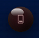
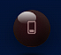

# Lumen Orbs Card

Una custom Lovelace card per Home Assistant che visualizza luci, interruttori e altre entità compatibili come sfere animate in stile vetro 3D.

> **Versione del file fornito:** 2.2.0  
> Il JavaScript incluso è stato copiato senza modifiche dal file ricevuto.

## Anteprima degli stili

La card offre tre stili grafici. Per ciascuno sono mostrate le varianti con entità accesa e spenta.

### Sfera di vetro 3D

| Accesa | Spenta |
|:---:|:---:|
|  |  |

### Reattore a plasma

| Acceso | Spento |
|:---:|:---:|
|  |  |

### Liquido

| Acceso | Spento |
|:---:|:---:|
|  |  |

## Funzionalità presenti nel codice

- Sfere 3D animate con tre stili: **Sfera di vetro**, **Reattore a plasma** e **Liquido**.
- Interazione rapida: tocco/click per l'azione prevista dal dominio; pressione prolungata per aprire i dettagli dell'entità.
- Layout a griglia oppure selezione di una stanza/gruppo alla volta.
- Gestione di gruppi (`rooms`) e di entità non assegnate a una stanza (`entities`).
- Colore acceso configurabile, colore spento configurabile e, quando disponibile e abilitato, colore RGB della luce.
- Stato opzionale sotto il nome dell'entità.
- Indicazione visiva per entità `unavailable`/`unknown`.
- Colori dedicati per i livelli di qualità dell'aria riconosciuti dal codice.
- Comandi “Spegni” per gruppo e “Spegni tutto”.

## Installazione manuale

1. Crea la cartella `www` nella configurazione di Home Assistant, se non esiste.
2. Copia `lumen-orbs-card.js` in `/config/www/`.
3. In Home Assistant apri **Impostazioni → Dashboard → Risorse**.
4. Aggiungi la risorsa:
   - URL: `/local/lumen-orbs-card.js`
   - Tipo: **Modulo JavaScript**
5. Ricarica la dashboard (se necessario, svuota la cache del browser).
6. Aggiungi una scheda manuale con `type: custom:lumen-orbs-card`.

## Installazione con HACS

Il repository è predisposto come **Lovelace dashboard plugin** tramite `hacs.json`. Per renderlo installabile da HACS:

1. Pubblica questa cartella in un repository GitHub pubblico.
2. Crea una release GitHub con un tag di versione, ad esempio `v2.2.0`.
3. In HACS aggiungi il repository come repository personalizzato, categoria **Dashboard** (il nome della categoria può variare secondo la versione di HACS).
4. Installa la card e verifica che il file JS venga aggiunto alle risorse della dashboard. Se HACS non aggiunge automaticamente la risorsa, aggiungila manualmente come indicato sopra.

**Nota:** la presenza di `hacs.json` non equivale a una validazione ufficiale HACS. Prima di distribuire pubblicamente, verifica la struttura e i requisiti correnti di HACS.

## Configurazione rapida

```yaml
type: custom:lumen-orbs-card
title: Luci
layout: grid
entities:
  - light.soggiorno
  - switch.lampada_scrivania
```

## Configurazione con stanze

```yaml
type: custom:lumen-orbs-card
title: Casa
layout: select
all_tab: true
rooms:
  - name: Soggiorno
    icon: mdi:sofa
    entities:
      - entity: light.soggiorno
        name: Luce principale
      - entity: light.pianta
        name: Luce pianta
  - name: Cucina
    icon: mdi:chef-hat
    entities:
      - entity: light.cucina
entities:
  - entity: switch.lampada_ingresso
    name: Ingresso
```

## Opzioni globali

| Opzione | Tipo | Predefinito nel codice | Descrizione |
|---|---|---:|---|
| `title` | stringa | — | Titolo della scheda. |
| `layout` | `grid` / `select` | `grid` | Tutti i gruppi in griglia oppure selezione di un gruppo alla volta. |
| `entities` | lista | `[]` | Entità non assegnate a una stanza. |
| `rooms` | lista | `[]` | Gruppi/stanza; ogni elemento può contenere `name`, `icon`, `entities`, oppure una singola `entity`. |
| `columns` | numero | automatico | Numero di colonne delle sfere nella griglia. |
| `room_columns` | numero | automatico | Numero di colonne dei riquadri stanza quando sono mostrati insieme. |
| `orb_style` | `orb` / `reactor` / `liquid` | `orb` | Stile animato della sfera. |
| `orb_scale` | numero | `1` | Scala globale delle sfere; il codice limita il valore effettivo tra 0,4 e 2. |
| `show_state` | booleano | `false` | Mostra una riga di stato sotto il nome. |
| `show_all_off` | booleano | `true` | Mostra il comando “Spegni tutto” quando almeno un'entità risulta accesa. |
| `all_tab` | booleano | `true` | Mostra la selezione “Tutte” nel layout `select`. |
| `color_off` | colore | colore interno predefinito | Colore della sfera quando è spenta. |
| `color_on` | colore | automatico | Colore globale quando è accesa; se omesso può essere usato il colore RGB della luce. |
| `color_name` | colore | tema Home Assistant | Colore dei nomi delle entità. |
| `use_light_color` | booleano | `true` se `color_on` non è impostato | Usa `rgb_color` dell'entità luce quando disponibile. |

## Opzioni per singola entità

Le voci di `entities` e `rooms[].entities` possono essere stringhe (`light.nome`) oppure oggetti.

| Proprietà | Descrizione |
|---|---|
| `entity` | ID dell'entità Home Assistant; obbligatorio negli oggetti. |
| `name` | Nome visualizzato personalizzato. |
| `icon` | Icona Material Design Icons, ad esempio `mdi:lightbulb`. |
| `color` / `color_on` | Colore personalizzato della sfera accesa. |
| `color_off` | Colore personalizzato della sfera spenta. |
| `air_quality` | Se impostato a `false`, disabilita il riconoscimento qualità aria per quel sensore. |
| `air_colors` | Colori personalizzati per le chiavi qualità aria riconosciute. |

Per `rooms`, il codice supporta:
- gruppo: `name`, `icon`, `entities`;
- singola entità: `entity`, `name`, `icon`.

## Esempio qualità dell'aria

Il codice riconosce stati come `excellent`, `very_good`, `good`, `fair`, `moderate`, `medium`, `poor`, `bad`, `unhealthy_for_sensitive_groups`, `severe`, `very_poor`, `unhealthy`, `danger`, `dangerous`, `hazardous` e `very_unhealthy`.

```yaml
type: custom:lumen-orbs-card
title: Qualità aria
entities:
  - entity: sensor.qualita_aria
    name: Qualità aria interna
    air_quality: true
    air_colors:
      excellent: "#00ff66"
      good: "#7fff00"
      moderate: "#ffd700"
      poor: "#ff9900"
      severe: "#ff3333"
      danger: "#b040ff"
```

## Interazioni e domini

Il comportamento dipende dal dominio dell'entità:

- `light`, `switch`, `input_boolean`, `fan` e gli altri domini non specializzati vengono gestiti tramite `homeassistant.toggle`.
- `lock`: usa `lock.lock` / `lock.unlock`.
- `automation`: usa `automation.turn_on` / `automation.turn_off`.
- `input_button`: usa `input_button.press`.
- `scene`, `script` e `button`: invocano rispettivamente `scene.turn_on`, `script.turn_on` e `button.press`.
- `sensor`, `binary_sensor` e `select`: aprono i dettagli, non eseguono un toggle.
- Pressione prolungata: apre sempre i dettagli dell'entità.

Il comando di spegnimento gruppo/tutto agisce sulle entità che risultano `on`, escludendo i domini con azioni dedicate (`scene`, `script`, `button`).

## Troubleshooting

- **La card non viene riconosciuta:** controlla URL e tipo della risorsa, quindi ricarica la dashboard.
- **Modifiche al JS non visibili:** prova un aggiornamento forzato del browser o svuota la cache.
- **Un'entità non cambia stato:** verifica che l'ID sia corretto e che l'utente/istanza abbia i permessi necessari.
- **Un sensore non si comporta come un interruttore:** è previsto; `sensor`, `binary_sensor` e `select` aprono i dettagli.
- **Un'entità appare lampeggiante:** il codice usa questo effetto per stati mancanti, `unavailable` o `unknown` (con alcune eccezioni per scene, pulsanti e script).

## Compatibilità

La card usa API frontend di Home Assistant come `ha-card`, `ha-form`, `ha-icon`, `ha-state-icon`, `hass.callService` e `hass.formatEntityState`. Il file non dichiara una versione minima di Home Assistant: la compatibilità va verificata nell'istanza di destinazione.

## Licenza

La licenza non è stata dedotta automaticamente dal codice. Prima della pubblicazione scegli una licenza e inserisci il relativo testo integrale in `LICENSE`. Il file `LICENSE` incluso è intenzionalmente un promemoria, non concede diritti d'uso.
